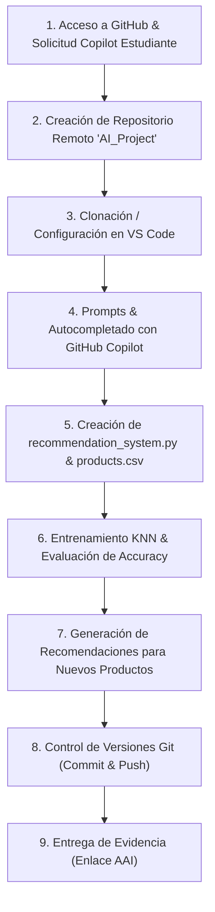

# Actividad Formativa: Tendencias Emergentes en IA con GitHub Copilot

> **Institución:** INACAP  
> **Asignatura:** Tendencias Emergentes en Inteligencia Artificial  
> **Proyecto:** Sistema de Recomendación Asistido por IA (`AI_Project`)  
> **Estudiante:** Gabriel  
> **Herramientas:** GitHub Copilot, Visual Studio Code, Python 3, Scikit-learn, Git & GitHub  

---

## 📋 Resumen del Proyecto

Este proyecto corresponde al desarrollo de la **Actividad Formativa: GitHub Copilot**, cuyo objetivo es explorar y aplicar las tendencias emergentes en inteligencia artificial utilizando **GitHub Copilot** como herramienta de pair programming y asistencia de código inteligente.

En este repositorio se implementa un **Sistema de Recomendación basado en Machine Learning (K-Nearest Neighbors)** para la clasificación y recomendación de productos a partir de vectores de características (`features`). El flujo de trabajo abarca desde la solicitud de la cuenta de estudiante de GitHub Copilot hasta el despliegue del repositorio remoto documentado.

---

## 🧠 Arquitectura y Flujo de Trabajo

El siguiente diagrama ilustra el flujo integral de la actividad, combinando el desarrollo asistido por IA (Copilot) y el pipeline de Machine Learning:



---

## 🛠️ Guía Paso a Paso del Proceso Desarrollado

A continuación se detalla cada una de las fases solicitadas en la pauta de la actividad:

### Paso 1 al 5: Registro y Configuración de GitHub Copilot
1. **Acceso a GitHub:** Ingreso a la plataforma oficial [https://github.com](https://github.com/).
2. **Solicitud de Cuenta de Estudiante:** A través del programa [GitHub Global Campus / Student Developer Pack](https://education.github.com/pack), se solicita el acceso educativo que incluye **GitHub Copilot Pro/Free for Students**.
3. **Planes y Precios:** Acceso al apartado de precios seleccionando la alternativa gratuita o el beneficio de estudiante verificado.
4. **Validación de Correo Institucional:** Verificación del correo electrónico educativo (`@inacapmail.cl`) para habilitar los permisos correspondientes.
5. **Autenticación en Visual Studio Code:** Instalación de la extensión oficial de **GitHub Copilot** y **GitHub Copilot Chat** en Visual Studio Code, iniciando sesión con las credenciales de GitHub verificadas.

---

### Paso 6 al 10: Creación y Configuración del Repositorio en GitHub
6. **Nuevo Repositorio:** En el panel principal de GitHub (Dashboard), clic en el botón verde **New**.
7. **Nombre del Repositorio:** Se designa el nombre **`AI_Project`** (o nombre del proyecto del curso).
8. **Visibilidad:** Selección de visibilidad **Público** (o **Privado** según solicitud docente).
9. **Inicialización:** Inclusión de archivo `README.md`, `.gitignore` configurado para Python y licencia.
10. **Creación:** Confirmación haciendo clic en **Create repository**.

---

### Paso 11: Clonación Local y Entorno de Trabajo
Para conectar el entorno local con el repositorio remoto, se ejecutaron los siguientes comandos en la terminal integrada de VS Code / PowerShell:

```bash
git clone https://github.com/Michibel/AI_Project.git
cd AI_Project
```

---

### Paso 12 y 13: Desarrollo del Sistema de Recomendación con GitHub Copilot
En Visual Studio Code se creó el archivo `recommendation_system.py`. Haciendo uso de comentarios como prompts dirigidos para GitHub Copilot (`# Importar las librerías necesarias`, `# Cargar los datos`, `# Preprocesamiento de datos`, etc.), la IA generó el código base de Machine Learning:

#### Código del Sistema (`recommendation_system.py`):
```python
# Importar las librerías necesarias
import numpy as np
import pandas as pd
from sklearn.model_selection import train_test_split
from sklearn.metrics import accuracy_score
from sklearn.neighbors import KNeighborsClassifier

# Cargar los datos (ejemplo: dataset de productos)
data = pd.read_csv('products.csv')

# Preprocesamiento de datos: Seleccionar características y etiqueta
features = data[['feature1', 'feature2', 'feature3']]
labels = data['label']

# Dividir los datos en entrenamiento y prueba (80% train, 20% test)
X_train, X_test, y_train, y_test = train_test_split(
    features, labels, test_size=0.2, random_state=42
)

# Crear y entrenar el modelo (K-Nearest Neighbors con k=3)
model = KNeighborsClassifier(n_neighbors=3)
model.fit(X_train, y_train)

# Realizar predicciones sobre el conjunto de prueba
y_pred = model.predict(X_test)

# Evaluar el modelo
accuracy = accuracy_score(y_test, y_pred)
print(f'Accuracy: {accuracy * 100:.2f}%')

# Función de recomendación
def recommend(product_features):
    prediction = model.predict([product_features])
    return prediction

# Ejemplo de uso de la función de recomendación
example_product = [1.0, 2.0, 3.0]
recommended_product = recommend(example_product)
print(f'Recommended Product: {recommended_product}')
```

#### Dataset de Soporte (`products.csv`):
Para garantizar la reproducibilidad y el correcto entrenamiento del algoritmo KNN, se elaboró un conjunto de datos representativo con tres atributos numéricos (`feature1`, `feature2`, `feature3`) asociados a categorías de producto (`Electronics`, `Fashion`, `Home & Kitchen`, `Books`, `Sports & Outdoors`).

---

### Paso 14: Documentación del Proceso
Se generó el presente archivo `README.md` estructurando:
- Justificación teórica del modelo de Machine Learning utilizado.
- Registro detallado de los comandos Git empleados.
- Instrucciones de replicabilidad y análisis de resultados.

---

### Paso 15 y 16: Versionamiento y Publicación en GitHub
Control de versiones ejecutado en terminal:

```bash
# 1. Agregar todos los archivos al área de preparación (staging)
git add .

# 2. Registrar el commit descriptivo
git commit -m "Add recommendation system example"

# 3. Vincular el repositorio remoto (si se inicializó localmente)
git remote add origin https://github.com/Michibel/AI_Project.git

# 4. Asegurar la rama principal y subir los cambios
git branch -M main
git push -u origin main
```

---

### Paso 17: Entrega de Evidencia
Se ha dispuesto un archivo de entrega estructurado (`Entrega_Proyecto_Copilot.txt`) con los metadatos requeridos por el docente para la evaluación en el Ambiente de Aprendizaje (AAI):
- Nombre del estudiante
- Correo institucional
- Enlace al repositorio GitHub (`https://github.com/Michibel/AI_Project`)
- Fecha de entrega y detalle de la actividad formativa

---

## 🚀 Cómo Ejecutar el Proyecto Localmente

### 1. Clonar o descargar el repositorio
```bash
git clone https://github.com/Michibel/AI_Project.git
cd AI_Project
```

### 2. Crear un entorno virtual (opcional pero recomendado)
```bash
python -m venv venv
# En Windows:
.\venv\Scripts\activate
# En Linux/macOS:
source venv/bin/activate
```

### 3. Instalar las dependencias requeridas
```bash
pip install -r requirements.txt
```

### 4. Ejecutar el sistema de recomendación
```bash
python recommendation_system.py
```

### 5. Salida esperada en consola:
```text
Accuracy: 100.00%
Recommended Product: ['Electronics']
```

---

## 📊 Conclusiones y Tendencias Emergentes Observadas

1. **Aceleración del Ciclo de Desarrollo:** El uso de asistentes basados en IA generativa como GitHub Copilot reduce drásticamente el tiempo de codificación boilerplate (importación de librerías, manipulación de datasets y partición de datos).
2. **Pair Programming Inteligente:** Copilot no solo autocompleta sintaxis, sino que infiere el contexto semántico del problema (en este caso, un pipeline clásico de scikit-learn con KNN).
3. **Buenas Prácticas:** La asistencia de IA debe complementarse siempre con validación manual, pruebas unitarias, documentación estructurada y buenas prácticas de control de versiones con Git.
